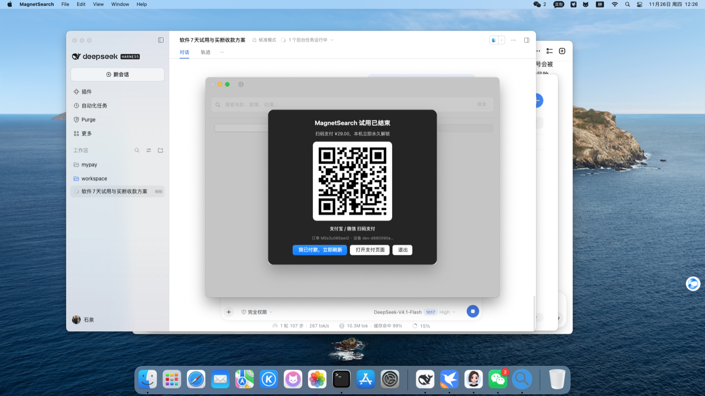

# 授权与收款（7 天试用 + 终身买断 + 免签收款）

给 MagnetSearch 加一层**设备授权**：装上就能用 7 天，到期弹收银台，扫码付完自动永久解锁，
之后软启动联网（或断网）都直接放行，不再打扰。

不是发卡、不是卡密、不是许可文件导入 —— 谈的是**「这台设备买断了」**这件事本身：

```
用户装软件 ──► 后端按设备记 7 天试用
                    │
      到期弹窗 ──► 扫码付款 ──► 支付平台回调 ──► 后端给这台设备打「永久」标记
                                                        │
                                    之后启动/定时联网校验 ◄┘
                                    → 已买断：直接进，终身可用（断网也认）
```



## 一分钟理解它由哪几块组成

| 组件 | 位置 | 干什么 |
|---|---|---|
| 授权服务 | `server/license_server.py`（纯标准库 + SQLite） | 试用登记、下单、回调验签、发凭证、后台 |
| 支付渠道适配 | `server/providers.py` | **付费墙+授权码** / 个人收款码（唯一金额+对账）/ V免签 / 易支付 / 自建聚合 |
| 客户端门禁 | `client/*.swift` → 注入 `libMagnetSearchLicense.dylib` | 判定试用/买断、拉收银台、离线验签 |
| 构建脚本 | `client/build_license.sh`、`client/apply_to_app.sh` | 编库、装进 app、重签 |
| 本地假支付网关 | `tools/fake_gateway.py` | 不花一分钱走通「下单→付款→解锁」全链路 |
| 自测 | `tools/selfcheck.py` | 13 项端到端断言，四种渠道都能跑 |

## 当前指向（生产）

* 下载页：`http://121.196.163.89:8899/download`（版本/大小/SHA256 自动列出，含安装与排错说明）
* 授权服务：`http://121.196.163.89:8899`（阿里云 ECS，systemd `magnetsearch-license`，详见 [docs/LICENSING.md](docs/LICENSING.md) §4.1.1）
* 客户端构建读 `licensing/config.json`（生产：云端地址 + 公钥，本机无签名私钥）
* 本地开发用 `licensing/config.dev.json`（本机自签密钥 + 假支付网关）：

```bash
MS_LICENSE_CONFIG=licensing/config.dev.json bash licensing/client/build_license.sh licensing/build-dev
MS_LICENSE_CONFIG=licensing/config.dev.json python3 licensing/server/admin.py serve
```

## 5 分钟本地跑通

```bash
cd MagnetSearch-macOS/licensing

# 0) 本地跑用 config.dev.json（生产 config.json 只带公钥，私钥在云服务器上）
export MS_LICENSE_CONFIG=licensing/config.dev.json

# 1) 初始化（生成密钥，打印公钥）
python3 server/admin.py init

# 2) 起本地授权服务
python3 server/admin.py serve                 # http://127.0.0.1:8899

# 3) 起假支付网关（模拟 V免签监控端；config.dev.json 已配好 monitor_base=http://127.0.0.1:8080）
python3 tools/fake_gateway.py --port 8080

# 4) 编注入库 + 装进 app
cd ..
MS_LICENSE_CONFIG=licensing/config.dev.json bash licensing/client/build_license.sh
bash licensing/client/apply_to_app.sh /Applications/MagnetSearch.app

# 5) 打开 app：先看到「已开始 7 天免费试用」
#    想直接看到收银台，把这条设备的试用起点拨回去：
python3 - <<'PY'
import sqlite3, time
db = 'licensing/license.dev.db'
c = sqlite3.connect(db)
c.execute("update devices set trial_start=? where 1", (int(time.time()) - 8*86400,))
c.commit()
PY
#    重启 app → 收银台 → 点开二维码链接 → 点「我已完成付款」→ 3 秒内自动解锁
```

接入真钱只需把 `payment.provider` 从 `vmq` 换成你实际用的渠道，见 [docs/LICENSING.md](docs/LICENSING.md)。

## 关键设计（为什么这么做）

**1. 试用判定在服务端，本地只是缓存。**
第一次联网上报设备指纹（`IOPlatformUUID` 的 SHA256，服务端只存哈希），服务端写 `trial_start` 并**永不改动**。
用户删本地文件、重装系统外的任何重装，拿回来的还是同一个起点 —— 删库重置试用这条路直接堵掉。

**2. 凭证是 Ed25519 签名，客户端只拿公钥。**
`MS1.<payload>.<sig>`，公钥编进 dylib。破解者能从二进制里掏出公钥，但掏不出私钥，伪造不了「我买断了」；
反向好处是**买断后可以彻底离线**，验签不需要联网，你的服务器挂了也不影响老用户。

**3. 价格和试用天数只在服务端配置里。**
客户端里的 `priceCents` 只用来显示，下单金额由服务端说了算，回调还要校验金额一致，改客户端改不了价。

**4. 三种状态机清晰**
`licensed`（放行）/ `trial`（放行 + 首次提示剩余天数）/ `trial_expired`、`blocked`（收银台或停用页）。

**5. 兼容已有注入链路。**
不碰主程序的 Mach-O 头：授权库由现有的 `libMagnetSearchPatch.dylib` 通过 `LC_LOAD_DYLIB` 带起来，
补丁库原生就有一个 constructor 钩子。这样 `patch/patch_license.py` 那套「关掉上游 24 小时试用」的改法可以退休了。

## 目录

```
licensing/
├── config.json                 # 一份配置：服务端 + 客户端构建共用（价格/试用/公钥/渠道）
├── keys/ed25519.key            # 签名私钥（0600，勿入库；已在 .gitignore）
├── server/
│   ├── license_server.py       # 授权服务入口
│   ├── store.py                # SQLite：devices / licenses / orders / events
│   ├── signer.py               # 凭证签发与校验
│   ├── ed25519.py              # 纯标准库 Ed25519（带 RFC 8032 自测向量）
│   ├── providers.py            # manual / vmq / epay / generic
│   ├── admin.py                # 管理 CLI（init/serve/grant/revoke/block/token/verify…）
│   └── config.py               # 配置与密钥管理
├── client/
│   ├── LicenseGate.swift       # 状态机 + 定时复查
│   ├── LicenseToken.swift      # 三段式凭证 + CryptoKit 验签
│   ├── DeviceIdentity.swift    # IOPlatformUUID → 设备指纹
│   ├── LocalState.swift        # 本地缓存（双份存储 + 时钟回拨保护）
│   ├── PaywallWindow.swift     # 收银台弹窗（sheet 挂在主窗口上，二维码由 CoreImage 生成）
│   ├── LicenseAPI.swift        # 会话/下单/轮询
│   ├── build_license.sh        # 编译 + 链接补丁库
│   └── apply_to_app.sh         # 装进 app 并重签
├── tools/
│   ├── selfcheck.py            # 端到端自测（13 项）
│   ├── fake_gateway.py         # 本地假支付网关
│   └── gen_client_config.py    # config.json → Swift 常量
├── deploy/                     # systemd / nginx / launchd
└── docs/LICENSING.md           # 部署、支付对接、风控、运维、发版
```

## 自测

```bash
python3 server/ed25519.py                        # RFC 8032 向量
python3 tools/selfcheck.py                       # generic 渠道全链路
python3 tools/selfcheck.py --provider vmq        # V免签（自带假监控端）
python3 tools/selfcheck.py --provider epay       # 易支付
python3 tools/selfcheck.py --provider manual     # 人工补单
```

## 下一步

* 部署到 VPS、接真钱、配 HTTPS、开后台 → [docs/LICENSING.md](docs/LICENSING.md)
* **用 8图片/北尚互联 这类「付费图 + 支付后跳转」平台**：`payment.provider=paywall`，
  付款成功跳转到 `/claim/<密钥>` 即发一张一次性授权码，用户填进 app 立刻永久解锁（线上就是这么配的，见 docs §5.5.1）
* **只有个人微信/支付宝收款码**：`payment.provider=manual` + 唯一金额尾数（¥29.47），
  到账后用 `python3 server/admin.py pay --amount 29.47` 一条命令补单，
  或直接跑 `python3 tools/reconcile.py 支付宝账单.csv --apply` 批量对账发证（详见 docs §5.1）
* 第三方「付费内容平台/8图片」类 API 不是收单通道，评估见 [docs/LICENSING.md](docs/LICENSING.md) §5.6
